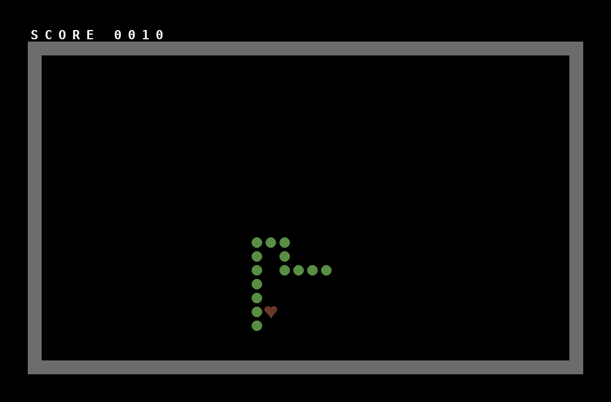

# C64-Snake-Game
Commodore 64 Snake Game, written in 6502 assembly.



## Play it

Load `snake.d64` in VICE (`x64sc snake.d64`) or on a real C64 (SD2IEC, Kung Fu Flash, Ultimate, Pi1541, or a floppy written from the image):

```
LOAD"SNAKE",8
RUN
```

**Controls:** joystick in port 2, or W A S D. Fire or any key restarts after game over.

Eat the hearts to grow and score. Hitting a wall or your own body ends the game.

## Build and test

Everything is plain Python 3. Pillow is only needed for screenshots.

```
python3 build.py        # snake.s -> snake.prg, snake.lst, snake.vs, snake.d64
python3 test_snake.py   # play-tests the game in the Python C64 emulator
```

The test boots the game, steers with the keyboard, lets a joystick autopilot eat 10 apples, crashes into a wall and into the snake's own body, and restarts. It writes screenshots to `shots/` (letters use a stand-in font, not the real C64 one).

## Files

| File | What it is |
|---|---|
| `snake.s` | Game source, for the assembler in `tools/` |
| `snake_kickass.asm` | The same game in KickAssembler syntax |
| `build.py` | Build script |
| `test_snake.py` | Automated play-test |
| `tools/asm6502.py` | Two-pass 6502 assembler (syntax notes at the top of the file) |
| `tools/cpu6502.py` | 6502 CPU emulator (official opcodes, decimal mode) |
| `tools/c64sim.py` | Minimal C64 for testing: raster, joystick, SID noise, GETIN, screenshots |
| `tools/d64.py` | Writes and lists 1541 `.d64` disk images |
| `snake.prg`, `snake.d64` | Built program and disk image |
| `snake.lst` | Assembly listing with addresses |
| `snake.vs` | Labels for the VICE monitor: `x64sc -moncommands snake.vs snake.prg` |

## How it works

- **Body:** a 256-entry ring buffer of X and Y positions with head and tail indexes, which wrap around on their own.
- **Collision:** reads the screen character where the head is going (space is safe, a heart is food, anything else ends the game).
- **Timing:** waits for raster line $FB each frame and moves every 6 frames, reading input on every frame.
- **Random apples:** SID voice 3 set to noise, read from $D41B.
